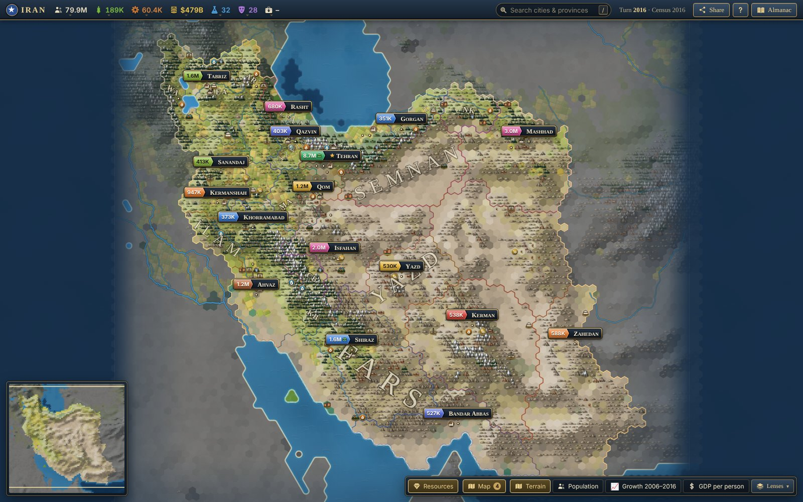
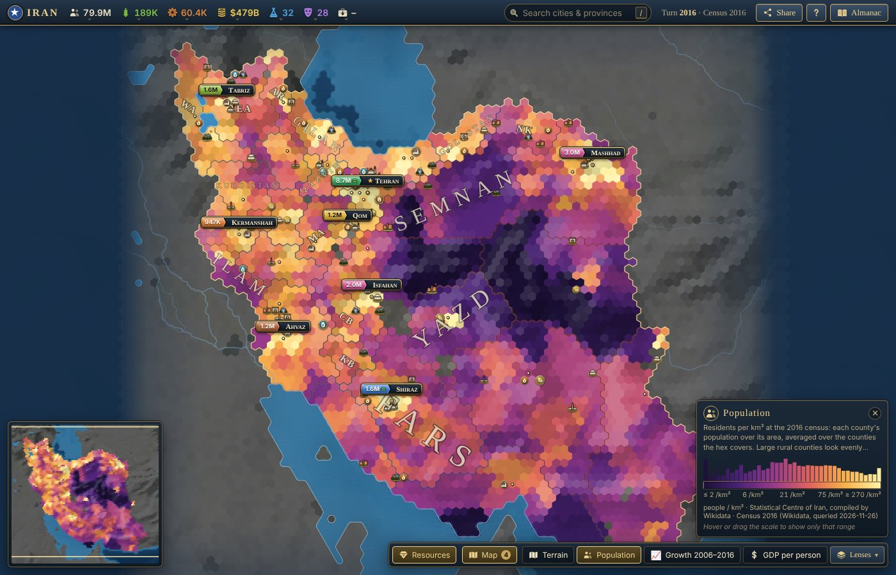
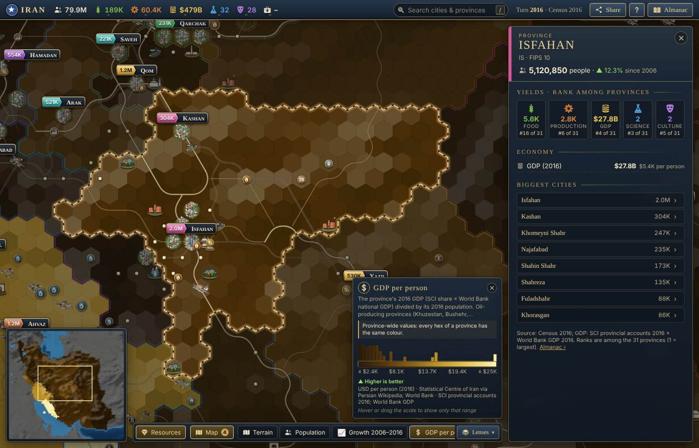

# iranciv: Iran as a strategy-game map, built from real data



A visualizer (not a game) that draws the **real** Iran like a turn-based 4X strategy map. It is a port of Andrej
Karpathy's [usaciv](https://karpathy.ai/usaciv/) (MIT), which does the same for the United States: the engine,
art and app are his; the data pipeline has been rewritten for Iran's public data. This is an independent fan build
in the genre, not affiliated with any game.

Hex terrain comes from elevation and satellite land cover. Provinces and counties (shahrestan) come from
OpenStreetMap. Cities have yield banners. Resources are real power plants, mines and oil and gas fields. Roads,
railroads, ports, airports and wonders sit on the tiles. Every number traces back to a public source in the in-app
**Almanac**.

<table>
  <tr>
    <td></td>
    <td></td>
  </tr>
</table>

## What's in it (v1)

- **The map.** 15 km hexes (2,926 on Iranian land) on an Albers equal-area projection. Relief from AWS Terrain
  Tiles, land cover from ESA WorldCover 2021, rivers and lakes from Natural Earth, 31 provinces and 478 counties
  from OpenStreetMap. Neighbouring countries are drawn under fog.
- **Cities.** The 265 cities of 30,000+ people at the 2016 census (via Wikidata), with province capitals. A city's
  area on the map is its county when it is the county's largest city.
- **Yields.**
  - **Gold** is GDP: each province's share in the Statistical Centre of Iran's provincial accounts (2016/17) times
    the World Bank's national GDP for 2016 ($479B). County and city GDP split the province's by population (an
    estimate, labelled as such).
  - Iran publishes no county jobs-by-industry table that this build can reach, so the other yields are mapped
    quantities rather than worker counts. **Food** is cropland area (km², WorldCover). **Production** is power-plant
    capacity (MW, WRI). **Science** counts prominent universities (Wikidata). **Culture** counts UNESCO World
    Heritage properties.
- **Lenses.** Population density and growth 2006–2016, GDP per person, earthquakes (USGS, M5.5+ since 1900) and
  their strongest magnitude, forest, farmland and built-up land.
- **Resources.** Gas, oil, hydro, wind and solar power plants (WRI Global Power Plant Database), oil and gas fields
  and mines with Wikidata coordinates. Nuclear sites and military installations are left out of this map.
- **Tile improvements and wonders.** Natural Earth roads, rail and ports; OurAirports airports with scheduled
  service; World Heritage properties, national parks and leading universities.
- **Turned off for now.** usaciv's City View (citizens and districts) and the nine Advisors read US-only tables
  (ACS, QCEW and others). They stay in the code but are not loaded (`web/js/ext/index.js`) until they are ported.

## Data sources

| Source | Used for | How it is fetched |
|---|---|---|
| OpenStreetMap boundaries via [iran-geojson](https://github.com/hosseinhabibi2004/iran-geojson) | Provinces, counties | Download, pinned commit |
| [Natural Earth](https://www.naturalearthdata.com/) 1:10m / 1:50m | Neighbours, lakes, rivers, roads, rail, ports | Download, pinned release |
| [AWS Terrain Tiles](https://registry.opendata.aws/terrain-tiles/) | Elevation and sea depth | Download |
| [ESA WorldCover 2021](https://esa-worldcover.org/) | Land cover | Download (needs `rasterio`, see below) |
| [WRI Global Power Plant Database](https://datasets.wri.org/dataset/globalpowerplantdatabase) | Power plants, Production | Download |
| [OurAirports](https://ourairports.com/countries/IR/) | Airports | Download |
| Census 2006/2011/2016 via [Wikidata](https://www.wikidata.org/) | Population, growth, cities | Manual snapshot |
| SCI provincial accounts via Persian Wikipedia; [World Bank](https://data.worldbank.org/indicator/NY.GDP.MKTP.CD?locations=IR) | GDP | Manual snapshot |
| Wikidata | World Heritage, parks, universities, mines, oil and gas fields | Manual snapshot |
| [USGS ComCat](https://earthquake.usgs.gov/earthquakes/search/) | Earthquakes | Manual snapshot |

"Manual snapshot" files live in `data/manual/` with the exact query and the date. Those services could not be
reached from the build machine, so they were queried in a browser; `data/manual/README.md` explains.

## Running it

```sh
uv run python -m pipeline all      # fetch → process → build → check
uv run python -m pipeline serve    # http://localhost:8000
```

The pipeline is standard-library Python, except the WorldCover fetch, which reads cloud-optimised GeoTIFFs with
`rasterio` (`pip install rasterio`). The processed land-cover grid is cached in `data/raw/worldcover/`, so only the
first fetch needs it. Run the tests with `PYTHONPATH=. uv run --with pytest pytest -q`.

The web app is static: serve `web/` from any static host. `docs/DATA_CONTRACTS.md` describes every JSON file; it
still uses usaciv's US wording in places, and the Iran differences are listed at its top.

## Known gaps

- Population is from the 2016 census, the latest complete count. Most cities and many counties have no 2006 figure
  in Wikidata, so their growth is blank (the growth lens falls back to the province rate).
- Natural Earth covers Iran's rivers, rail and ports sparsely (no Karun or Zayandeh Rud; three ports).
- Oil and gas fields and mines are only those with Wikidata coordinates, not a full inventory.
- Power plants stop at 2021 (WRI's last update).

## Credits

Engine, art and app: [usaciv](https://karpathy.ai/usaciv/) by Andrej Karpathy, MIT licence (see `LICENSE`).
Iran data pipeline: this repository.
